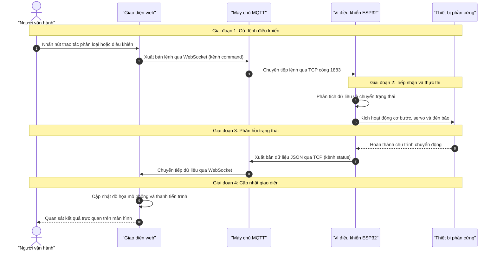
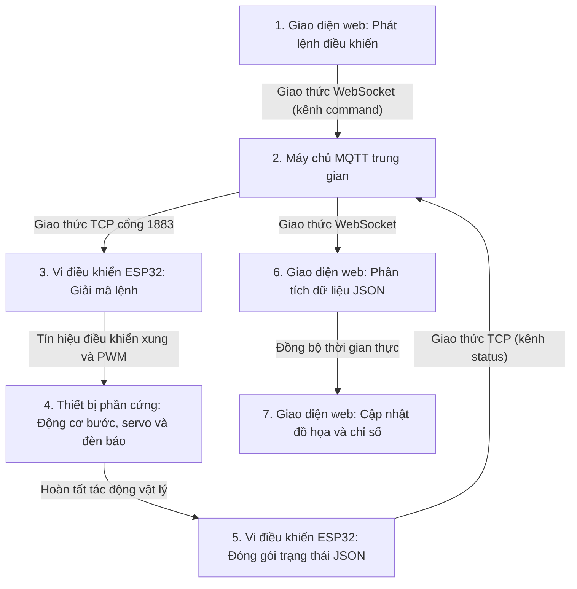

# Hướng dẫn và giải thích nguyên lý hoạt động của hệ thống phân loại rác tái chế thông minh

Tài liệu này giải thích cấu trúc, các thành phần và nguyên lý hoạt động chi tiết của hệ thống phân loại rác tái chế thông minh (Đề tài 59 - Nhóm 13).

---

## 1. Giới thiệu tổng quan về hệ thống

Hệ thống được thiết kế để tự động hóa quy trình phân loại các loại rác tái chế phổ biến, nhằm giảm bớt công sức phân loại thủ công và nâng cao hiệu quả tái chế rác thải rắn.

Hệ thống phân loại rác thành 4 nhóm chính:
- Nhôm (các loại lon nước ngọt, lon bia).
- Sắt và thép (các chi tiết kim loại có từ tính, bu-lông, ốc vít).
- Nhựa (các loại chai lọ, hộp nhựa).
- Rác không xác định hoặc rác khác (các vật thể lạ đưa vào khu vực kiểm tra thủ công).

Toàn bộ hệ thống được xây dựng dựa trên sự phối hợp chặt chẽ giữa 3 khối thành phần:
1. Khối điều khiển cục bộ: Sử dụng vi điều khiển ESP32, mô phỏng trực quan trên phần mềm Wokwi cùng các cảm biến và cơ cấu chấp hành.
2. Khối truyền thông trung gian: Sử dụng giao thức MQTT để trao đổi dữ liệu hai chiều thông qua máy chủ điều phối EMQX trên đám mây hoặc máy chủ Mosquitto cục bộ trong môi trường Docker.
3. Khối giám sát và điều khiển: Giao diện web cho phép người quản lý theo dõi trạng thái hoạt động của dây chuyền theo thời gian thực và gửi lệnh điều khiển từ xa.

---

## 2. Các thành phần phần cứng và vai trò

Mạch phần cứng của hệ thống bao gồm các thiết bị chính được kết nối với vi điều khiển ESP32:

### 2.1. Vi điều khiển trung tâm ESP32
Vi điều khiển ESP32 đóng vai trò xử lý toàn bộ thuật toán điều khiển, thu thập tín hiệu từ các cảm biến, điều khiển động cơ và đóng gói dữ liệu để gửi lên máy chủ qua mạng không dây.

### 2.2. Khối động cơ và điều khiển chuyển động
- Động cơ bước và mạch điều khiển A4988: Được kết nối với chân 25 (bước), chân 26 (chiều quay) và chân 27 (kích hoạt). Khối này làm nhiệm vụ kéo băng chuyền đưa rác thải di chuyển dọc theo dây chuyền phân loại.
- Động cơ servo SG90: Được kết nối với chân 23. Động cơ này điều khiển cánh gạt để chuyển hướng rác vào từng thùng chứa tương ứng tùy theo góc quay:
  - Góc 30°: Đưa rác vào thùng chứa nhôm.
  - Góc 70°: Đưa rác vào thùng chứa sắt và thép.
  - Góc 110°: Đưa rác vào thùng chứa nhựa.
  - Góc 150°: Đưa rác vào khu vực kiểm tra dành cho rác không xác định.
  - Góc 90°: Vị trí ban đầu ở giữa khi không thực hiện thao tác gạt rác.

### 2.3. Khối cảm biến và các nút bấm mô phỏng
- Nút phát hiện vật thể (chân 32): Mô phỏng cảm biến quang phát hiện rác bắt đầu đi vào buồng nhận diện.
- Nhóm nút bấm mô phỏng nhận diện vật liệu: Chân 14 (nhôm), chân 17 (sắt và thép), chân 19 (nhựa) và chân 22 (rác không xác định). Nhóm nút này mô phỏng tín hiệu trả về từ mô hình AI thị giác máy tính sau khi xử lý hình ảnh chụp từ camera.
- Nút dừng khẩn cấp (chân 33): Giúp ngắt toàn bộ hoạt động của hệ thống ngay lập tức khi phát hiện sự cố bất thường.
- Nút đặt lại thùng chứa (chân 12): Dùng để khôi phục chỉ số dung tích của các thùng chứa về mức 0% sau khi nhân viên đã thu gom rác.

### 2.4. Khối phát tín hiệu cảnh báo
- Đèn LED màu xanh (chân 4): Sáng khi hệ thống đang vận hành ở trạng thái bình thường.
- Đèn LED màu đỏ (chân 5): Bật sáng hoặc nhấp nháy khi thùng rác bị đầy, hệ thống có cảnh báo hoặc đang kích hoạt dừng khẩn cấp.
- Còi báo (chân 15): Phát âm thanh cảnh báo ngắt quãng khi thùng rác sắp đầy, hoặc kêu liên tục khi xảy ra dừng khẩn cấp hay thùng chứa đã đạt mức giới hạn.

---

## 3. Nguyên lý và chu trình vận hành của hệ thống

Quy trình vận hành của hệ thống được quản lý thông qua mô hình máy trạng thái với 5 trạng thái vận hành chính.

### 3.1. Các trạng thái hoạt động chính
1. Trạng thái chờ vật liệu (`WAIT_MATERIAL`):
   - Động cơ băng chuyền hoạt động để di chuyển vật liệu.
   - Cánh gạt servo duy trì ở vị trí ban đầu 90°.
   - Đèn LED xanh sáng báo hiệu dây chuyền sẵn sàng tiếp nhận rác.

2. Trạng thái chờ nhận diện (`WAIT_AI`):
   - Khi cảm biến phát hiện có rác đi tới khu vực camera, băng chuyền tạm dừng lại.
   - Hệ thống chờ dữ liệu phân tích vật liệu từ mô hình AI thị giác máy tính hoặc từ nút bấm mô phỏng.

3. Trạng thái phân loại (`SORTING`):
   - Sau khi nhận được kết quả nhận diện, vi điều khiển kiểm tra dung tích thùng chứa tương ứng.
   - Nếu thùng chứa còn chỗ, băng chuyền tiếp tục chạy, đồng thời động cơ servo quay cánh gạt đến góc tương ứng với loại rác.
   - Cánh gạt giữ nguyên vị trí trong khoảng 2 giây để vật thể trượt vào đúng thùng chứa.
   - Mức chứa của thùng rác được cộng thêm tương ứng với kích thước vật thể, sau đó cánh gạt servo quay trở lại vị trí gốc 90°.
   - Hệ thống chuyển về trạng thái chờ vật liệu tiếp theo.

4. Trạng thái dừng do thùng đầy (`BIN_FULL_STOP`):
   - Khi mức chứa của một thùng rác chạm ngưỡng cảnh báo từ 90% trở lên, hệ thống sẽ từ chối tiếp nhận thêm loại rác đó để tránh tình trạng tràn thùng.
   - Nếu người dùng vẫn tiếp tục đưa loại rác này vào, băng chuyền sẽ dừng lại, đèn LED đỏ sáng và còi báo động được kích hoạt.
   - Hệ thống chỉ mở lại trạng thái hoạt động sau khi người vận hành nhấn nút đặt lại thùng chứa để đổ rác.

5. Trạng thái dừng khẩn cấp (`EMERGENCY_STOPPED`):
   - Kích hoạt ngay lập tức khi người vận hành nhấn nút dừng khẩn cấp trên mạch hoặc bấm nút tương ứng trên trang web.
   - Toàn bộ băng chuyền dừng ngay, cánh gạt servo quay về vị trí ban đầu 90°, đèn LED đỏ sáng và còi báo động kêu liên tục.
   - Trong trạng thái này, mọi lệnh phân loại rác đều bị vô hiệu hóa cho đến khi nút dừng khẩn cấp được nhấn lại một lần nữa để giải phóng khóa an toàn.

---

## 4. Luồng truyền thông dữ liệu qua giao thức MQTT

Hệ thống áp dụng mô hình truyền thông theo cơ chế xuất bản và đăng ký nhận dữ liệu thông qua giao thức MQTT, tạo cầu nối giữa thiết bị phần cứng và giao diện giám sát.

### 4.1. Các kênh truyền dữ liệu chính
- Kênh thông báo trạng thái (`nhom13/recycling/status`):
  - Do vi điều khiển ESP32 xuất bản.
  - Dữ liệu được gửi định kỳ theo chu kỳ nhịp tim hoặc gửi tức thời ngay khi có sự thay đổi trạng thái trong hệ thống.
  - Giao diện web đăng ký nhận kênh này để cập nhật thông số lên màn hình giám sát.
- Kênh gửi lệnh điều khiển (`nhom13/recycling/command`):
  - Do giao diện web xuất bản khi người vận hành thao tác trên các nút bấm.
  - Vi điều khiển ESP32 đăng ký nhận kênh này để tiếp nhận các lệnh: nhận diện vật liệu (`ALUMINUM`, `STEEL`, `PLASTIC`, `UNKNOWN`), dừng khẩn cấp (`EMERGENCY`), hoặc đặt lại thùng chứa (`EMPTY_BIN`).

### 4.2. Cấu trúc bản tin dữ liệu trạng thái định dạng JSON
Bản tin trạng thái được vi điều khiển ESP32 chuẩn hóa theo định dạng JSON với các thông số:
- `state`: Trạng thái hoạt động hiện thời của vi điều khiển.
- `conveyor`: Tình trạng bật hoặc tắt của động cơ băng chuyền.
- `servoAngle`: Góc quay hiện tại của động cơ servo.
- `material`: Loại vật liệu đang được xử lý trong chu trình.
- `bin`: Tên thùng chứa rác đích đến.
- `confidence`: Độ tin cậy tính theo phần trăm của kết quả nhận diện.
- `bins`: Mức dung tích chứa hiện tại của 4 thùng rác (nhôm, sắt và thép, nhựa, kiểm tra).
- `emergency`: Cờ báo trạng thái dừng khẩn cấp đang bật hay tắt.
- `warning`: Cờ báo mức chứa của thùng rác đã vượt ngưỡng cảnh báo 80%.
- `full`: Cờ báo thùng rác đã đạt mức tối đa từ 90% trở lên.
- `message`: Chuỗi ký tự mô tả vắn tắt tình trạng hệ thống phục vụ hiển thị nhật ký vận hành.

---

## 5. Chức năng của giao diện web giám sát

Giao diện web phục vụ công tác giám sát và quản lý từ xa với các chức năng chính:
- Hiển thị mô phỏng trực quan: Sử dụng khung vẽ đồ họa tái hiện chuyển động của băng chuyền, vị trí vật thể rác và chuyển động gạt rác của cánh gạt servo theo thời gian thực.
- Bảng hiển thị thông số đo lường: Thể hiện rõ ràng trạng thái hoạt động của hệ thống, góc quay của cánh gạt, trạng thái băng chuyền và mức đầy của từng thùng chứa rác qua các thanh tiến trình trực quan.
- Bảng điều khiển từ xa: Cung cấp các nút tương tác giúp người vận hành có thể thử nghiệm phân loại từng loại rác, kích hoạt hoặc giải phóng dừng khẩn cấp, đặt lại thùng rác và bật chế độ tự động thử nghiệm cấp rác liên tục.
- Nhật ký hệ thống: Ghi lại toàn bộ lịch sử các sự kiện phân loại, cảnh báo quá tải và thay đổi trạng thái kèm theo mốc thời gian rõ ràng.

---

## 6. Luồng dữ liệu hai chiều giữa giao diện người dùng và mạch điều khiển

Luồng dữ liệu giữa giao diện web và mạch vi điều khiển ESP32 được tổ chức theo một chu trình tuần hoàn khép kín gồm 4 bước chính:

### 6.1. Chiều gửi lệnh từ giao diện web xuống mạch điều khiển
1. Người vận hành tương tác trên giao diện web (nhấn nút chọn loại rác cần phân loại như nhôm, sắt và thép, nhựa, hoặc nhấn nút dừng khẩn cấp, đặt lại thùng rác).
2. Mã nguồn JavaScript trên trình duyệt đóng gói thao tác thành một chuỗi lệnh điều khiển tương ứng (ví dụ: `ALUMINUM:M`, `STEEL:L`, `EMERGENCY`, hoặc `EMPTY_BIN`).
3. Ứng dụng web sử dụng thư viện MQTT qua giao thức WebSocket (cổng bảo mật 8084 trên máy chủ đám mây EMQX hoặc cổng 9001 trên máy chủ Mosquitto cục bộ) để xuất bản gói tin lệnh này lên kênh điều khiển `nhom13/recycling/command`.

### 6.2. Tiếp nhận và xử lý lệnh tại vi điều khiển ESP32
1. Máy chủ MQTT trung gian nhận gói tin từ trình duyệt và lập tức chuyển tiếp đến vi điều khiển ESP32 thông qua kết nối TCP tiêu chuẩn ở cổng 1883.
2. Hàm xử lý thông điệp nhận được (`mqttCallback`) trên vi điều khiển ESP32 được kích hoạt, tiến hành phân tích nội dung chuỗi ký tự nhận được để xác định lệnh và kích thước vật liệu.
3. Vi điều khiển chuyển đổi trạng thái của máy trạng thái sang trạng thái tương ứng (ví dụ: chuyển sang `SORTING` khi phân loại rác, hoặc `EMERGENCY_STOPPED` khi có lệnh dừng khẩn cấp).
4. ESP32 điều khiển trực tiếp các cơ cấu phần cứng:
   - Phát xung điện kích hoạt mạch điều khiển A4988 để điều khiển động cơ bước kéo băng chuyền.
   - Phát tín hiệu điều chế độ rộng xung đến động cơ servo SG90 để quay cánh gạt đến đúng góc phân loại (30°, 70°, 110° hoặc 150°).
   - Bật tắt đèn LED trạng thái và còi báo động phù hợp với chu trình xử lý.

### 6.3. Chiều phản hồi dữ liệu từ vi điều khiển lên giao diện web
1. Sau khi xử lý lệnh và cập nhật các chỉ số hoạt động nội bộ (như góc quay servo, trạng thái máy, mức tăng dung tích thùng rác), hàm xuất bản dữ liệu trạng thái (`publishTelemetry`) trên vi điều khiển ESP32 được gọi.
2. Vi điều khiển đóng gói toàn bộ trạng thái thực tế của hệ thống thành một chuỗi dữ liệu định dạng JSON gồm các trường: trạng thái máy, tình trạng băng chuyền, góc quay servo, tên vật liệu, mức đầy của từng thùng chứa và các cờ cảnh báo.
3. ESP32 xuất bản gói tin JSON này qua kết nối TCP cổng 1883 lên kênh thông báo trạng thái `nhom13/recycling/status`.

### 6.4. Tiếp nhận dữ liệu và cập nhật giao diện người dùng
1. Máy chủ MQTT chuyển tiếp gói tin JSON từ kênh `nhom13/recycling/status` qua kết nối WebSocket về lại trình duyệt web.
2. Trình duyệt bắt sự kiện nhận tin nhắn mới, tự động phân tích cú pháp chuỗi JSON thành đối tượng dữ liệu trong JavaScript.
3. Hàm hiển thị dữ liệu trạng thái (`renderTelemetry`) thực hiện cập nhật toàn diện giao diện người dùng:
   - Khung vẽ đồ họa 2D vẽ lại chuyển động của băng chuyền, vị trí vật thể rác và chuyển động góc quay của cánh gạt servo một cách trực quan, đồng bộ với góc quay thực tế trên mạch.
   - Nhãn trạng thái hệ thống, chỉ số góc servo và nhãn thông báo kết quả nhận diện được cập nhật nội dung và màu sắc tương ứng.
   - Các thanh tiến trình biểu diễn mức đầy của từng thùng chứa rác được nâng lên theo đúng dung tích mới.
   - Dòng thông báo nhật ký hệ thống ghi nhận sự kiện vừa hoàn thành kèm mốc thời gian chi tiết, hoàn tất một vòng truyền thông dữ liệu khép kín.

### 6.5. Sơ đồ luồng hoạt động tóm tắt

Dưới đây là sơ đồ trình tự thể hiện chu trình khép kín của luồng dữ liệu giữa giao diện web và mạch điều khiển:

Sơ đồ khối tóm tắt chu trình truyền thông tuần hoàn:

